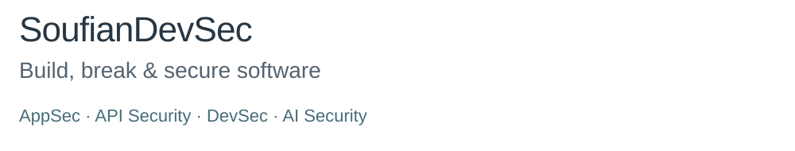

<picture>
  <source media="(max-width: 768px) and (prefers-color-scheme: dark)" srcset="assets/hero-mobile-dark.svg">
  <source media="(max-width: 768px)" srcset="assets/hero-mobile.svg">
  <source media="(prefers-color-scheme: dark)" srcset="assets/hero-dark.svg">
  
</picture>

  
  
  
  

## Build, break & secure software

I'm **Soufian**. I bring a full-stack engineering background to **application and AI security**.

I build software, investigate how it breaks, and share practical ways to secure
it. My technical breakdowns explore where trust boundaries belong and how to
verify that a defense actually changes the outcome.

My focus spans **AppSec, API Security, DevSec and AI Security**, with cloud
security as a supporting interest. My current AI work explores how application
code controls the actions proposed by language models.

## Focus areas

| Area | What I explore |
| :--- | :--- |
| **Application security** | Trust boundaries, authorization and secure design |
| **API security** | HTTP, authentication, access control and practical attack paths |
| **DevSec** | Secure software development and checks that engineers can inspect |
| **AI security** | Agent tool permissions, data access and observable execution |

## Sharing practical security

I share security breakdowns for engineers on [YouTube](https://www.youtube.com/@SoufianDevSec) and [Instagram](https://www.instagram.com/soufiandevsec/).

## Connect

[Website](https://soufiandevsec.com) · [LinkedIn](https://www.linkedin.com/in/soufian-benafia/) · [YouTube](https://www.youtube.com/@SoufianDevSec) · [Instagram](https://www.instagram.com/soufiandevsec/)

Build the software. Inspect the boundary. Verify the result.
